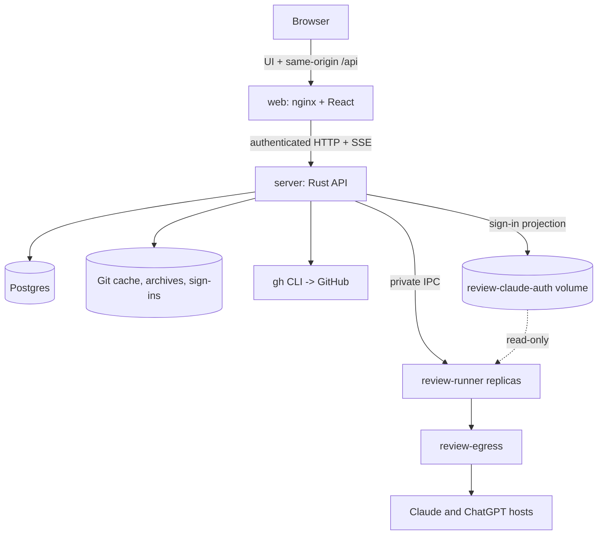

# Architecture

OpenCodeReview is a Docker application: a React web UI, a Rust HTTP backend backed by Postgres, and isolated review runners. There is no message broker and no hosted component. Long-running work (polling, indexing, reviews, publication, cleanup) runs as bounded background jobs inside the `server` container, and every AI execution runs in a runner container.

## Services

| Service | Port | Role |
| --- | ---: | --- |
| `web` | `1421` | nginx serving the built React app and proxying `/api` to `server`. |
| `server` | `127.0.0.1:8787` | Rust API (`ocr-server`): GitHub integration, indexing, review orchestration, publication, sign-in flows and background workers. Also publishes `127.0.0.1:1455` for the ChatGPT browser sign-in callback, forwarded only while a sign-in runs. |
| `review-runner` | none | `ocr-sandbox runner`: executes Claude Code or Codex on a frozen review snapshot, one stage per container at a time. `OCR_REVIEW_RUNNERS` replicas (20 by default) share the `review-ipc` volume, each listening on `/ipc/<hostname>.sock`; the server lists the sockets to find them and removes those whose runner is gone. Settings → PR selection → Reviews at a time (20 by default) limits how many reviews run at once. |
| `review-egress` | none | `ocr-sandbox egress`: a CONNECT proxy that admits only the AI provider hosts. Runner networks are internal and reach the internet only through it. |

Volumes: `ocr-data` (database, repository cache, index, review archives, settings and sign-ins), `review-claude-auth` (read-only sign-in projection for runners) and one IPC volume per runner. The runtime uses built images and named volumes only: no source bind mounts, no host credential folders, no Docker socket.

## Review runners

- Runners receive only their IPC socket and a read-only projection of the AI sign-ins. They never mount `ocr-data` or repository checkouts, and they cannot reach the database.
- The containers are read-only, drop all capabilities except the few the supervisor needs, use `no-new-privileges`, and limit CPU, memory and process count. The AI process runs as an unprivileged UID separate from its supervisor.
- Claude Code runs as `claude --print` with a fixed model and effort (`claude-opus-5-5`, medium), JSON streaming output, no MCP servers, no session persistence, no slash commands and an explicit tool list (`Read`, `Grep`, `Glob`, `Bash`, `Write`). `Agent`, `Task`, `WebFetch`, `WebSearch` and `mcp__*` are denied, and a `PreToolUse` hook (`ocr-sandbox tool-guard`) checks every tool call. Shell access is limited to bounded reads, searches and listings inside the snapshot.
- Codex runs as `codex exec` with medium reasoning effort, the CLI's default model, ephemeral sessions and user config, extensions and web search disabled. Codex's own sandbox cannot start inside the hardened runner, so the container is the sandbox.
- The sign-in reaches the process only through its environment or a private per-stage home directory. Output that contains the account's tokens is rejected, and transcripts are kept outside paths the model can read.
- The backend and runner images share an executor fingerprint (`ocr-sandbox engine-version`). A mismatched runner fails before any AI call, and there is no fallback that runs the AI inside `server`.
- Every CLI version is pinned in [`docker/Dockerfile`](../docker/Dockerfile) with per-architecture SHA-256 checksums and auto-update disabled.

## Accounts and failover

Settings → Accounts holds Claude and ChatGPT accounts in one priority order. Each review stage uses the first account that is enabled, signed in and not resting, trying the first account's provider before the other: a limit moves reviews to that provider's other accounts before another provider's. When a stage hits a usage limit, that account rests until the reset time reported by the provider (or one hour when none is given) and the same stage runs again on the next account. A rejected sign-in marks the account as needing attention. Settings shows each account's remaining plan usage and the top bar shows it for the account the next review uses, refreshed every five minutes.

## Backend

Rust crate `opencodereview-server` in [`backend/`](../backend/Cargo.toml) with two binaries: `ocr-server` and `ocr-sandbox` (`runner`, `egress`, `engine-version`, `tool-guard`).

| Area | Modules |
| --- | --- |
| HTTP API and jobs | `server/` |
| Reviews | `review/` (`mod.rs`, `frozen.rs`, `execution.rs`, `scope.rs`, `coverage.rs`, `chunks.rs`, `integration/`, `evidence.rs`, `validation.rs`, `findings.rs`), `review_archive/` |
| AI CLIs | `providers/` (`claude.rs`, `codex.rs`), `accounts/` (`mod.rs`, `usage.rs`) |
| Sandbox | `sandbox/` (`mod.rs`, `runner.rs`, `egress.rs`, `read_commands.rs`), `accounts/sandbox_sync.rs` |
| Indexing | `indexer/` |
| GitHub | `github/` (all calls go through the authenticated `gh` CLI) |
| Persistence | `db/` |

## Frontend

React 19, TypeScript and Vite, built into static files served by nginx ([`docker/Dockerfile.web`](../docker/Dockerfile.web)). Routing uses TanStack Router ([`src/router.tsx`](../src/router.tsx)) with pages under `/platform`: reviews, indexing, skills and settings, plus `/onboarding`. Server state uses TanStack Query with HTTP clients in [`src/services/`](../src/services). The review canvas uses React Flow and the skill editor uses TipTap. Styling is Tailwind with theme tokens in [`src/styles/globals.css`](../src/styles/globals.css).

## Persistence

Postgres, run by Compose as the `postgres` service on an internal network only `server` joins. The server works through connection pools: one for reads and writes, a read-only one for read paths, and one that sees only the `scratch` schema, where each review indexes its pull request's head commit. A connection is held for one step at a time, never across Git, GitHub or model calls. Transactions that decide from a pull request's state lock its row first, so concurrent work on one pull request runs in turn.

Migrations live in [`backend/src/db/pg/`](../backend/src/db/pg) and are listed in [`migrate.rs`](../backend/src/db/pg/migrate.rs). They run once at startup under an advisory lock and are recorded in `schema_migrations`. New migrations are appended and applied ones are never edited. A database newer than the application fails explicitly. Installs that ran on SQLite move their data with `ocr-server import-sqlite` ([upgrading](upgrading.md)).

Several server instances can share the database ([`docker-compose.scale.yml`](../docker-compose.scale.yml)). Each one records a heartbeat and the reviews and indexing it runs, so only the work of a stopped instance is interrupted. Queued reviews start on whichever instance has a free slot. Polling, indexing, archive retention and other background jobs run on one instance at a time.

| Area | Tables |
| --- | --- |
| Setup | `workspaces`, `repos`, `subscriptions`, `settings`, `ai_accounts` |
| Pull requests | `pull_requests`, `pending_actions`, `pr_comment_activations`, `comment_activation_receipts`, `comment_scan_cursors`, `queue_acknowledgements`, `review_request_restorations` |
| Index | `repo_index_state`, `repo_index_files`, `repo_index_packages`, `repo_index_pkg_deps`, `repo_index_edges`, `repo_index_symbols`, `repo_index_symbol_edges`; per-review copies in `scratch` |
| Review archives | `archive.artifacts`, `archive.receipts`, `archive.uploads`, `archive.deletions`, `archive.retention_queue`, `archive.retention_events` |
| Instances | `server_instances` |
| Reviews | `review/` (`mod.rs`, `frozen.rs`, `execution.rs`, `scope.rs`, `coverage.rs`, `chunks.rs`, `integration/`, `evidence.rs`, `validation.rs`, `findings.rs`), `review_archive/` |
| Skills | `skill_versions` |

Frozen review archives live under `/data/review-archives` with a 4 GiB quota; their index is in the `archive` schema. Archives of merged pull requests are deleted one day after merge by an hourly cleanup job; review results, findings and usage are kept. Named volumes hold all state, so do not use `docker compose down -v` as a normal restart.

## API security

Non-public API endpoints require a bearer token. The server uses `OCR_API_TOKEN` when set, otherwise it generates and persists `/data/api-token`. The web container injects that token into the built JavaScript, so it is installation-level protection, not per-user authentication: anyone who can load the UI can call the API. Keep OpenCodeReview on a trusted network or behind an authenticated reverse proxy.

State-changing endpoints also require the request origin to match `OCR_WEB_APP_URL`. nginx forwards `Origin` unchanged and derives it from `Referer` only when the browser sent none.

## Credentials

| Path in `ocr-data` | Contents |
| --- | --- |
| `/data/xdg-config/gh` | GitHub CLI sign-in created by the onboarding device flow. |
| `/data/accounts/<id>/claude/oauth-token` | Claude Code token from `claude setup-token` (mode `0600`). |
| `/data/accounts/<id>/codex/auth.json` | ChatGPT sign-in from `codex login` (mode `0600`). Refreshed sign-ins returned by a review replace it. |

OpenCodeReview never manages its own GitHub tokens; `GH_TOKEN` is only a development fallback.
