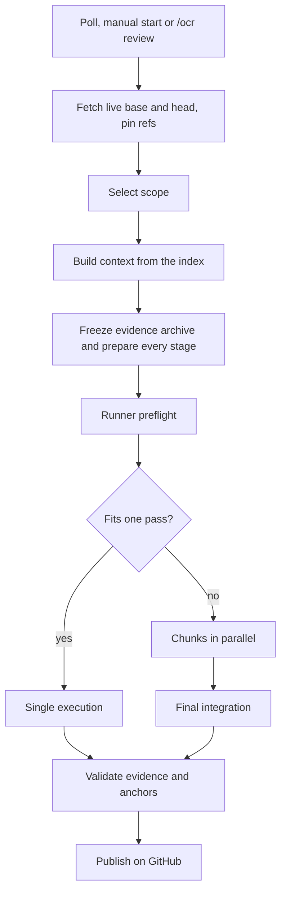

# Pull request reviews

OpenCodeReview reviews normal and stacked GitHub pull requests in isolated runner containers, validates every finding against a frozen snapshot of the code, and publishes the validated result on GitHub. The review workspace is at `/platform/reviews`.

## When a review starts

- The server polls monitored repositories on the configured interval and queues pull requests that match **Settings → PR selection**.
- You can start a review from the Reviews page at any time.
- The pull request author can comment `/ocr review` to queue the first review, including on a draft. Edited comments, bots, non-authors and comments from before monitoring started are ignored.

When a review is accepted, OpenCodeReview posts a short **queued for review** comment naming the commit, and deletes it once the result is on GitHub. Up to 10 reviews run at once; at most three AI processes run at the same time across all reviews. Pull requests with more files than the configured maximum (default 100) are skipped before any AI call.

## Lifecycle



Progress is stored as structured phase snapshots and streamed to the UI over server-sent events. The review canvas shows each stage, its elapsed time and its token usage; chunked reviews expand into one block per chunk.

| Status | Meaning |
| --- | --- |
| `queued` | Waiting for a free review slot. |
| `reviewing` | Running or publishing. |
| `ready` | Validated, waiting for a decision. |
| `auto_posted` / `posted` | Published on GitHub. |
| `skipped` / `size_skipped` | Skipped by a person, or larger than the file limit. |
| `manual_required` | OpenCodeReview could not continue safely and needs your action. |
| `failed` / `cancelled` | The run failed (the error is shown) or was interrupted. |
| `superseded` | A newer push replaced this run. |

## Scope

Reviews always compare against the **live immediate base** of the pull request and pin the base, head and merge-base commits. A failed fetch fails the review instead of falling back to stale refs or the default branch. OpenCodeReview never checks out branches; it reads Git objects directly.

| Mode | When |
| --- | --- |
| Full | First review, explicit full request, or no provable reuse. |
| Incremental | The previous head is an ancestor of the new head and the merge-base is unchanged: only the new changes are reviewed. |
| Base sync | The base branch moved (for example, it was merged into the PR). Files whose content is exactly reproduced by a clean merge are reused; conflicts and new edits are reviewed. |
| Stacked integration | A child PR was merged or rebased into its parent; already-verified child coverage is reused. |

Coverage from earlier reviews is reused only when it can be verified against Git byte for byte. When nothing reviewable changed, OpenCodeReview records a "no new changes" result without calling the AI. Stacked PRs (base other than the default branch) are reviewed against their own base, not the default branch.

## Context

Each stage receives a context pack:

```text
CONTEXT.md              changed files, packages, related files, tests
PR.md                   pull request title and description
PR_DIFF.patch           the diff under review
changed/                changed files at the pinned head
related/                related code selected from the index
conventions/            convention files at the pinned base
skill/SKILL.md          the active review skill
```

Related code comes from the [index](indexing.md): owning and dependent packages, files that import or are imported by the changed files, and tests in the same package. Convention files are `REVIEW.md`, `AGENTS.md`, `CONVENTIONS.md`, `CONTRIBUTING.md`, `CLAUDE.md`, `.cursorrules` and `README.md` at the repository root.

GitHub file links pinned to a commit, branch or tag in the PR description, and submodules, are resolved to exact commits and added as read-only supporting evidence.

The whole permitted repository at the pinned revisions is also available to the AI as a read-only archive. Symlinks, binary, generated and non-UTF-8 files, oversized files and private configuration paths (`.git`, `.ssh`, `.gnupg`, `.mcp.json`, and the settings, MCP servers, sign-ins and session state inside agent folders such as `.claude`, `.agents`, `.cursor`) are excluded. Committed agent instructions, skills and scripts in those folders are reviewed from the archive only: they are never copied into the AI's workspace, where its CLI could load them as configuration. Path rules do not guarantee that arbitrary code contains no secrets.

## Depth and chunking

Reviews use Auto depth: a pull request with fewer than 10 reviewable files, or that fits one pass, is reviewed in a single execution. Larger ones are split into chunks of about 5 related files, up to 6 in parallel, followed by a final integration pass that merges and deduplicates the chunk results and checks cross-file interactions. Successful chunk results are cached for seven days and reused when the inputs are identical.

Stage inputs are bounded (8 MiB and 5,000 files per stage, 200,000 bytes of rendered prompt). Total inference time per execution is capped at 15 minutes.

## Validation

The AI returns a structured JSON report; OpenCodeReview renders the GitHub comments itself. Validation requires:

- every assigned file to be covered;
- every quote to match the snapshot exactly at the stated revision;
- every inline finding to anchor to an added or removed line of the diff;
- counter-evidence that the AI checked before asserting a defect.

A report that fails validation fails the run; it is never relabelled as clean. A stage may get **one** extra execution to repair invalid anchors or quotes, keeping the original findings. Exact duplicate comments are merged.

Missing supporting evidence is reported as a warning on the result when every primary file and finding still validates.

## Publication on GitHub

Publication is automatic and uses the GitHub account you signed in with:

- **Summary comment**: one collapsed comment per pull request with an overview, confidence, important files and a small flowchart. It is updated on each push and never contains findings.
- **Findings**: the validated findings and questions are posted as one non-blocking `COMMENT` review with inline comments. Findings that cannot be anchored to a line go in the review body.
- **Result comment**: when a review is clean, a result comment is posted and earlier result comments from the same installation are deleted.
- **Stale approvals** from OpenCodeReview are dismissed after new commits.

OpenCodeReview never approves a pull request on its own. Publication uses the exact validated selection and never overwrites human edits. If posting consumes a pending review request for your account or team, OpenCodeReview restores it. You can still review the findings in the app, change the selection and publish manually when a run needs a decision.

Comments carry hidden `<!-- ocr-... -->` markers so OpenCodeReview can find and update its own comments.

## Token usage

Usage is reported in tokens only (input, output, cache read, cache creation), taken from the CLI's final result event. There are no cost estimates. Usage from failed, repaired and superseded executions is kept.

The **Usage** page shows token usage over the last 7, 30 or 90 days, for every repository or one. Days are your browser's calendar days.

- **Tokens** are input + output + cache creation, the same figure as a run's usage in Reviews. **Read from cache** (context the provider re-read from its prompt cache) is shown apart and not counted in Tokens.
- **Reused chunks** are chunks whose earlier review result was reused because their code did not change; no model call was made for them. This is OpenCodeReview's own cache, not the provider's.
- **Findings** count the findings and questions reviews kept, published or not; **posted** is the part published to GitHub.
- **Median time** is a run's execution, from its first stage starting to its last stage finishing; time the run waited before its first stage is not counted.
- **Re-review overhead** is the tokens of runs that failed, were cancelled, or were superseded by a newer commit before being published.

The breakdown lists pull requests, repositories, models and accounts. A pull request opens into its runs in the window, newest first, with each run's commit, outcome, account, model, time, tokens and findings, and a link to the review.

**Share** draws an image of the period's totals (tokens, reviews, pull requests, findings, median time and the daily chart) to download or copy. It has no repository, pull request, account or model names.

Each execution of a review stage records the account and model it ran on, including executions abandoned when an account hit its usage limit. Usage from before this was recorded appears as **Unattributed** in the model, provider and account breakdowns, so each breakdown still adds up to the total.

## Archive retention

Frozen archives of merged pull requests are deleted one day after merge by an hourly cleanup job. Open and closed-but-unmerged pull requests keep their archives, and review results, findings and usage are never deleted. To preview or run a cleanup by hand:

```bash
docker compose exec -T server ocr-server archive-retention          # preview
docker compose exec -T server ocr-server archive-retention --apply  # apply
```

## Source map

| Area | Source |
| --- | --- |
| Orchestration | `backend/src/review/mod.rs`, `review/execution.rs`, `review/frozen.rs`, `review/chunks.rs` |
| Scope and coverage | `backend/src/review/scope.rs`, `review/coverage.rs` |
| Archive | `backend/src/review_archive/` |
| Evidence and validation | `backend/src/review/evidence.rs`, `review/validation.rs`, `review/output_repair.rs`, `review/findings.rs` |
| Final integration | `backend/src/review/integration/` |
| Publication | `backend/src/server/publication.rs`, `server/summary.rs`, `server/status_comments.rs` |
| Usage | `backend/src/db/usage_report.rs`, `server/usage_http.rs`, `src/platform/pages/usage/` |
| Runners | `backend/src/sandbox/`, `accounts/sandbox_sync.rs`, `providers/` |
